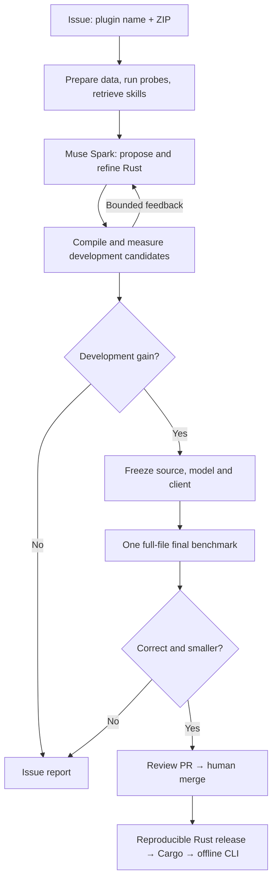

# 🗜️ Algomini

<p>
  
  
  
  
  
</p>

**Give your data its own compressor.**

<p align="center">
  
</p>

### [Build a compression plugin](https://github.com/akaliutau/algomini/issues/new?template=codec.yml) · [See the results](#measured-results) · [Cloud setup](docs/cloud.md)

Algomini turns a GitHub issue into a compression experiment—and a qualifying result into a Rust release. Give it a plugin name and a ZIP dataset. The laboratory investigates patterns, retrieves relevant research skills, asks **Meta Muse Spark 1.3** to write and refine Rust candidates, and measures complete archives against gzip, xz and zstd.

Passing candidates reach a review PR. After merge, the release workflow rebuilds the qualified implementation and publishes a console client you can install with Cargo. Compression then runs locally, with no Python, model credentials or network connection.

> **AI proposes the algorithm. Exact reconstruction and measured bytes decide what qualifies.**

---

## Why

General-purpose compressors are strong. Specialized data can still offer useful structure: repeated JSON keys, exact numeric spellings, column layouts or predictable language contexts. Finding an advantage requires a reversible representation, working code and careful accounting.

**Algomini automates that research loop and keeps the evidence in GitHub.** It combines candidate coding, deterministic probes, measured feedback, reusable knowledge and a path from experiment to installed software.

The goal is a compressor adapted to a workload, with source and measurements that a reviewer can inspect.

## Demo

1. Open **[Develop a compression plugin](https://github.com/akaliutau/algomini/issues/new?template=codec.yml)**.
2. Fill in two fields:

   | Field | Example |
   | --- | --- |
   | Plugin name | `text-demo` |
   | Dataset archive URL | [books2.zip](https://github.com/akaliutau/algomini-datasets/raw/refs/heads/main/gutenberg.org/books2.zip) |

3. Watch the linked Actions run prepare the dataset, investigate patterns and benchmark candidates.
4. Read the issue's result table, algorithm summary and source links.
5. Review and merge a qualifying PR.
6. Copy the Cargo installation command posted to the issue, then use your plugin:

   ```bash
   algomini compress --plugin text-demo input.txt output.alc
   algomini decompress output.alc restored.txt
   cmp input.txt restored.txt
   ```

With two dataset files, the larger becomes development data and the other becomes final data. Larger collections split approximately 70:30 by file count. The manifest is generated automatically; public HTTP/HTTPS downloads support redirects and query parameters.

**Research sees the first 2 MiB of development data. Qualification measures the complete files.** A maintainer's request starts automatically; other requests need maintainer authorization. A run that cannot beat the baseline produces a report. Reusing a reviewed winner produces a qualification PR; a newly generated winner includes its Rust source.

[Dataset preparation, permissions and retries →](docs/cloud.md#dataset-and-issue)

## Measured results

The included Rust codecs beat the strongest configured baseline on these supplied samples:

| Workload | Input bytes | Algomini archive | Best baseline archive | Smaller archive |
| --- | ---: | ---: | ---: | ---: |
| Shakespeare text | 5,422,721 | **1,434,371** | 1,656,213 · xz | **13.39%** |
| Dumas text | 2,704,417 | **644,368** | 764,445 · xz | **15.71%** |
| JSON development fixture | 1,026,294 | **8,269** | 8,801 · xz | **6.04%** |

These are complete archive sizes, including framing and shared models, with exact reconstruction. The text files use three and two independent chunks respectively. Executable size is reported separately.

The measurements use existing reviewed codecs on known local regression samples. The JSON fixtures contain repeated records; these figures do not establish unseen-data performance or guarantee a win on another dataset.

[Measurement method, artifacts and reproduction →](docs/benchmarks.md)

## How it works



The laboratory uses deterministic byte, entropy, repetition and structure probes to guide experiments. Muse receives relevant skills, parent source, measured archive costs and failure feedback. Candidate generation and repair cycles are bounded by configuration and spending reservations.

A candidate must pass validation and full-development checks before the final claim. Source, model and client are frozen first; final results cannot trigger further tuning. The release rebuild must reproduce the qualified executable and development archive.

[Research and qualification →](docs/cloud.md#research-and-results) · [Release and installation →](docs/cloud.md#merge-release-and-install)

## Research memory

Research skills live in Git as **`.agents/skills/NAME/SKILL.md`**, with metadata describing their applicable families and tools. A portable keyword/semantic index helps the laboratory find relevant procedures and earlier development evidence. Retrieval is bounded to four documents and 6,000 excerpt characters.

Campaigns retain development successes and failures for later searches. Reviewed skills and codecs become shared knowledge after merge. The coding model's weights stay fixed; improvement comes from better evidence, tools, retrieval and controlled experiments.

Extend the system by adding a focused skill, a registered laboratory probe or a Rust codec implementing the existing interface.

[Define a skill →](docs/laboratory.md#define-or-improve-a-skill) · [Add a tool →](docs/laboratory.md#add-a-laboratory-tool) · [Extend an algorithm →](docs/laboratory.md#add-or-improve-an-algorithm)

## Design principles

| Principle | Implementation |
| --- | --- |
| **Exact bytes** | Preserve whitespace, quoting, numeric spellings and binary content; verify reconstruction. |
| **Count complete archives** | Include payloads, frames, metadata and shared models. Track the executable separately. |
| **Measure strong baselines** | Compare against gzip, xz and zstd, including development-trained dictionary controls. |
| **Keep final data outside research** | Separate artifacts, a frozen candidate and one durable final claim. |
| **Bound cost and execution** | Spending reservations, finite coding cycles and contained workers with time/memory limits. |
| **Make results reviewable** | Commit source/model identities, reports and receipts; distinguish generated winners from reused codecs. |
| **Ship the qualified snapshot** | Human merge, pinned build image, reproducible rebuild and verified release checksums. |

[Protocol and operational details →](docs/cloud.md) · [Reproducibility records →](repro/README.md)

## Quick start

Try the existing text codec locally. Use Linux, Rust 1.92+ and a C compiler; repository access is required. GitHub CLI users can configure Git authentication with `gh auth login` and `gh auth setup-git`.

```bash
git clone https://github.com/akaliutau/algomini.git
cd algomini
cargo install --path crates/algomini-cli --locked --force

algomini plugins
algomini compress --plugin wiki-xml datasets/sample/Dumas-1.txt dumas.alc
algomini decompress dumas.alc dumas.restored.txt
cmp datasets/sample/Dumas-1.txt dumas.restored.txt
```

`wiki-xml` is the existing text/PPM codec alias; it also accepts plain text. Other built-in choices include `json-lexical`, `telemetry-csv` and `general`. A cloud-generated release adds the plugin name from its issue. The issue's installation command selects its exact qualified source tag.

For a qualified cloud release, copy the command from its issue. It has this form, with `N` replaced by the issue number:

```bash
CARGO_NET_GIT_FETCH_WITH_CLI=true cargo install \
  --git https://github.com/akaliutau/algomini.git \
  --tag codec-issue-N algomini-cli --locked --force
```

To run research in GitHub, configure the GitHub App credentials and Meta API key once. Installed compressors need none of those credentials.

[Cloud credentials and setup →](docs/cloud.md#credentials) · [Local laboratory and tests →](docs/development.md) · [Rust client →](crates/algomini-cli/README.md)

## Stack

| Layer | Technology |
| --- | --- |
| Candidate coding | Meta Muse Spark 1.3 through the Muse CLI |
| Laboratory and orchestration | Python 3.12+, deterministic probes and native process measurements |
| Research memory | Markdown skills, SQLite FTS5/BM25, Model2Vec embeddings and a Git-versioned index |
| Compression runtime | Rust, bundled zstd and reviewed specialized codecs |
| Cloud execution | GitHub Actions, Docker and GHCR images pinned by digest |
| Review and delivery | GitHub App, pull requests, release artifacts and Cargo source installation |
| Native containment | Linux Landlock and seccomp |

## PoC scope

| Boundary | Current behavior |
| --- | --- |
| Research input | First **2 MiB** of development data |
| Complete files | Up to **64 MiB** per file/partition |
| Larger-file encoding | Independent **2 MiB** chunks; whole files buffered in memory |
| Dataset ZIP | Up to **128 MiB** downloaded and expanded, with 2–64 data files |
| Selection | Archive size first; speed secondary, with mandatory resource limits |
| Release threshold | Positive archive saving; **10%** is the target |
| Plugin delivery | Compiled into the Rust client; updates require installing a newer build |
| Release platform | Linux x86_64 |

Compression efficiency depends on the workload and chunk boundaries. Final measurements remain independent of the coding loop; known fixtures remain regression evidence. Existing release tags retain their original clients and limits—large-file support starts with client 0.3.1.

## Explore further

| Question | Guide |
| --- | --- |
| How do issues become experiments, PRs and releases? | [GitHub workflow](docs/cloud.md) |
| What do the benchmark numbers include? | [Benchmarks and evidence](docs/benchmarks.md) |
| How are skills stored, searched and improved? | [Research, skills and extension](docs/laboratory.md) |
| How do I reproduce results and run checks? | [Local development](docs/development.md) |
| Which versions and hashes are recorded? | [Reproducibility](repro/README.md) |
| Where are the earlier experiments? | [Historical Git revisions](docs/history.md) |

## Vision

Make specialized compression an accessible engineering workflow: supply data, investigate a mechanism, measure it honestly and ship the implementation that earns its place.

The same research loop can keep improving as its collection of skills, tools and measured examples grows. Every proposed compressor has a concrete test: reconstruct the original bytes and justify the archive it produces.

## License

[MIT](LICENSE). Dataset provenance and embedded notices are described with the [supplied samples](datasets/sample/README.md).
