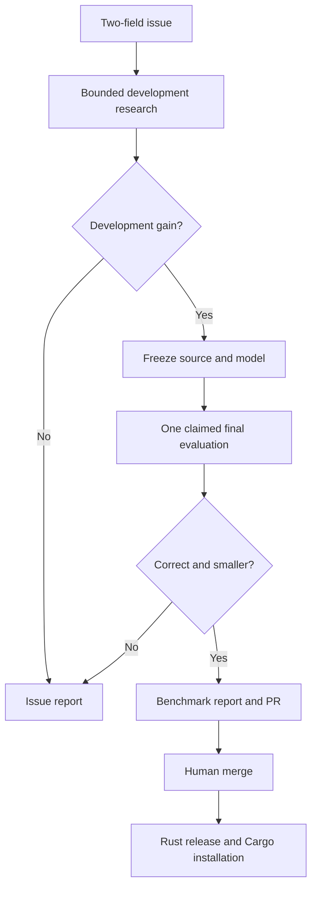

# Algomini

Algomini researches specialized lossless compressors, measures them against strong baselines, and ships reviewed algorithms in a Rust console client. A GitHub issue supplies a plugin name and a dataset manifest. Research runs in a pinned cloud laboratory; installed compressors run locally without Python, AI credentials or network access.



The client preserves arbitrary bytes, including malformed text and binary data, within the **2 MiB per-file demo limit**. JSON, JSONL, CSV, XML and text guide research and seed selection. A codec uses a byte fallback when its specialized representation does not help. Compression wins depend on the data; a valid no-win report is a supported outcome. Archive size ranks first and speed is secondary, with hard time/memory limits.

The reviewed JSON lexical codec uses **8,269 bytes versus xz's 8,801** on the included 1 MB development fixture, and **8,217 versus 8,725** on the known 0.5 MB regression fixture. These are complete archives, with exact console reconstruction. The fixtures repeat the same object population; they are regression evidence, not a new unseen-data claim. See [validation and limitations](reports/stability/report.md).

After a qualified issue PR merges:

```bash
gh auth login
gh auth setup-git
CARGO_NET_GIT_FETCH_WITH_CLI=true cargo install \
  --git https://github.com/akaliutau/algomini \
  --tag codec-issue-123 algomini-cli --locked --force

algomini plugins
algomini compress --plugin your-plugin input.json output.alc
algomini decompress output.alc restored.json
```

Replace `123` and `your-plugin` with the values in the issue's release report. The repository is private, so source installation needs Git access. The built-in `general` alias supports arbitrary content; `json-lexical`, `telemetry-csv` and `wiki-xml` expose reviewed mechanisms.

- [Cloud workflow and setup](docs/cloud.md): issue fields, dataset manifests, credentials, retries and releases.
- [Research, skills and extension](docs/laboratory.md): how knowledge is stored, retrieved and improved; how to add tools and algorithms.
- [Local development](docs/development.md): installation, checks and fixture reproduction, without Docker.
- [Historical experiments](docs/history.md): immutable Git references for the retired numbered stages.
