# GitHub cloud demo: implementation plan for the next 24 hours

Status: proposed work, 3 November 2026. This document does not enable workflows, spend money, create GitHub resources or publish a release.

## Readiness and the smallest useful demo

**We are ready to attempt a cloud smoke test. The complete issue → research → PR → Cargo demo still needs implementation.** The repository has contained Rust workers, bounded Muse generation, reproducible local evidence, campaign preparation, shared skills and semantic retrieval. It has no GitHub workflows, remote run ledger, general train/test campaign controller or user-facing Rust CLI. Current installed packages still use a Python launcher, and historical evaluator freezes bind local native binaries. Moving them into an arbitrary runner will not automatically pass verification.

For the deadline, use GitHub Actions for orchestration and a Docker image built/run in the cloud. Publish Linux x86_64 binaries and source tags through GitHub Releases. Provide one Cargo-installable Rust CLI containing approved codec versions. Keep one paid campaign running at a time. No new web service, database, Kubernetes cluster, plugin marketplace or separate bot account is needed.

```mermaid
flowchart LR
    A[Issue: plugin + dataset manifest] --> B[Validate and durably claim]
    B --> C[Research using development file]
    C --> D[Commit frozen source and build]
    D --> E[Consume final test once]
    E --> F[Issue report and development PR]
    F --> G[Maintainer merges passing PR]
    G --> H[Build and publish GitHub Release]
    H --> I[Cargo install and compress by plugin name]
```



Research can fail to beat the baselines. That outcome produces a report, without a releasable codec. The workflow must demonstrate measured compression savings, rather than promise an improvement for arbitrary datasets. Size is primary; speed is secondary. The existing Wikipedia result is a useful known example, not a new unseen test.

## User contract: exactly two issue fields

Create `.github/ISSUE_TEMPLATE/codec.yml` with two required inputs:

| Field | Example | Meaning |
| --- | --- | --- |
| Plugin name | `wiki-xml` | Logical codec name to create or extend; validate a lowercase slug. |
| Dataset manifest URL | `https://raw.githubusercontent.com/OWNER/datasets/FULL_COMMIT/wiki-demo.json` | One immutable JSON descriptor naming the development and final-test files. |

Use a manifest instead of adding separate URL, checksum, format and sampling fields to the issue. It contains `schema_version`, `family` (`csv`, `json`, `xml`, `text` or `binary`), provenance/license, and `train`/`test` entries. Each entry has a public HTTPS URL, exact byte count and SHA-256. Start with already extracted raw files of about 1 MB each; enforce the existing 2 MiB per-input cap. Reject archives and arbitrary download/extraction commands in the first demo.

Example manifest shape; replace the placeholders with real immutable URLs and full checksums:

```json
{
  "schema_version": 1,
  "family": "xml",
  "provenance": {"source": "Wikipedia/enwik8", "license": "See upstream attribution"},
  "train": {"url": "https://APPROVED_HOST/IMMUTABLE_REF/dev.xml", "bytes": 1000000, "sha256": "FULL_SHA256"},
  "test": {"url": "https://APPROVED_HOST/IMMUTABLE_REF/test.xml", "bytes": 1000000, "sha256": "FULL_SHA256"}
}
```

The `train` file is the development dataset: profiling, coder examples, candidate training and selection may use it. Any internal training/validation split is fixed in policy before generation. Only training bytes train a shared model or reference dictionary. The `test` file is fetched and opened only by final verification after source/model/build selection is committed. Record any previously examined test as reused evidence; it cannot be advertised as unseen. Reject identical train/test hashes and retain test-consumption history by content hash.

Initially allow public files on an explicit host allowlist, with bounded downloads and validated redirects. Do not accept credentials, private-network URLs or executable instructions in the descriptor. Private datasets can follow after the demo.

## Trigger and idempotency

The form adds `codec-request`. An `issues: opened` event starts requests created by users with repository write/maintain/admin permission. For an external issue, validation explains that a maintainer must add `codec-run`; an `issues: labeled` event from that authorized maintainer can then start the same request. Verify actual repository permission through the API, not just a displayed author association. Ignore other labels, issue edits, reopening and comments. Use a single handler for both start paths. [GitHub documents issue event types and default-branch workflow requirements.](https://docs.github.com/en/actions/reference/workflows-and-actions/events-that-trigger-workflows#issues)

Keep identity simple:

```text
request_id      = repository + issue_number
development_ref = codec/issue-123
release_tag     = codec-issue-123
```

The first accepted request stores an immutable snapshot: both fields, manifest SHA-256, dataset checksums, trusted base commit, policy, cloud image digest and evaluator identity. Later field or policy changes do not create another attempt under the same issue. Use a new issue for new work. Do not use Actions run IDs or attempts as research identities.

Store small JSON state on a separate `automation-state` branch, not in the checkout cache. Include the shared budget ledger and `requests/issue-123.json`. Advance state with conditional, fast-forward Git updates; never force-push the state branch. A durable claim and spending reservation must succeed before inference. This is enough for a single-repository demo; a database is unnecessary.

```text
accepted → reserved → researching → frozen → test-consumed → reported → pr-open → released
                                     any failure → failed/interrupted
```

Use one repository-wide paid-workflow concurrency group, `cancel-in-progress: false` and `queue: max`. GitHub's default concurrency queue replaces an older pending run, so `cancel-in-progress: false` alone is insufficient. Concurrency serializes work; the remote state prevents duplicate execution after completion. [Concurrency behavior](https://docs.github.com/en/actions/reference/workflows-and-actions/workflow-syntax#concurrency).

On a rerun, return the existing state, report, branch and PR. Never repeat a paid call with an uncertain outcome. If a runner disappears, preserve its reservation and mark the attempt interrupted; operator reconciliation is required before more spending for that request. A test claim without a stored terminal result remains consumed. Report/release publication can retry from checksummed evidence without calling the model or reading the final dataset again.

Run the publisher with an `always()` condition for normal job failures. If the whole workflow is canceled or lost, the next delivery/rerun checks the linked Actions run, records `interrupted` and updates the comment without restarting research. Do not require a separate monitoring service for the demo.

Actions caches and artifacts are useful transports, not the authoritative ledger: artifacts expire. Commit claims, receipts, source/model hashes and final summaries; retain bulk working outputs as bounded artifacts. [Artifact retention](https://docs.github.com/en/actions/how-tos/manage-workflow-runs/download-workflow-artifacts).

## Two implementation stages

### C1 — cloud qualification and an installable Rust client, hours 0–8

1. **Prove the host first, within two hours.** Add `cloud/Dockerfile`, a pinned image/dependency description and a no-secret smoke workflow. Build/run Docker only in GitHub, respecting the local no-Docker rule. Check actual Landlock ABI >=6, libseccomp, worker file/network/process denial and offline Rust compilation inside the container. Docker shares the host kernel; an image cannot add missing Landlock support. If container seccomp blocks necessary calls, add a narrowly scoped profile; keep worker containment mandatory. If hosted runners fail these checks, use one disposable self-hosted Linux VM with the required kernel; do not weaken containment to meet the deadline.
2. Record image digest, runner image/kernel, CPU, Python, Rust, compiler, zstd and native library identities. Pin Python 3.12.16, Rust 1.92.0 and Muse from existing reproduction inputs where practical. Create a **new cloud evaluator reference inside each campaign workspace**, binding the reviewed verifier, client adapter, baseline commands, objective and image. Preserve every original local freeze and report. Do not regenerate historical pins to hide native differences. The hosted runner software changes, so record the actual environment rather than assuming its label fixes it. [Runner image inventory](https://github.com/actions/runner-images/blob/main/images/ubuntu/Ubuntu2404-Readme.md).
3. Add a separate `crates/algomini-cli/` crate with its own lockfile: package `algomini-cli`, binary `algomini`. Leave the frozen `rust/codec-worker/` tree and its workspace behavior unchanged. Implement `plugins`, `compress --plugin NAME`, `decompress` and `--version`. The first release handles one input up to 2 MiB; larger-file chunking is deferred.
4. Compile approved codec source modules through a trusted registry adapter. Keep generated modules behind `forbid(unsafe_code)`. Store logical aliases separately from immutable source/model IDs. Archives contain the actual codec identity, so decoding selects the recorded version automatically; an alias update must not break old archives. Keep earlier released codec versions available.
5. Implement compatible ALC1/ALG2 framing and bounded decoding in the new client, using the existing contracts as the reference. Count complete metadata and shared models. Bundle approved models in the release and include their counted archive cost. Prefer a pinned bundled/static zstd dependency in this new crate so installation does not require a separate libzstd setup. Cargo still needs Rust and a native compiler during source installation. This changes the release runtime: verify raw/zstd fallback and measure its actual archive bytes; do not copy the old worker's performance claim onto it. [Rust zstd bindings](https://github.com/gyscos/zstd-rs).
6. Pass malformed/truncated-input tests, model/codec identity checks, tiny binary/text cases and cross-language archive tests. Install the client into an empty directory, encode a development sample, delete the supplied original and decode exactly. Compile both existing successful mechanisms before adding paid automation.

**C1 exit:** one real cloud containment/build report and a Cargo-installed Rust client working without Python, Meta credentials or network access at compression time. If this is not working by hour eight, stop expanding scope and fix it first.

### C2 — issue orchestration, PR and release, hours 8–20

Use ordinary Actions YAML and a small typed request/state helper, not a general agent framework. Reuse campaign preparation, probes, bounded retrieval, coder adapter, accounting concepts and native measurement logic. Extract the Wikipedia-specific paths into campaign configuration; do not create another corpus-specific controller or reopen its consumed test.

| Job | Responsibility | Credentials |
| --- | --- | --- |
| Intake | Parse the issue, authorize, pin inputs, durably reserve budget and claim request. | GitHub App; no Meta key. |
| Research | Download development bytes; retrieve skills; generate, repair and select using bounded local tests. | Meta key; read-only repository access. |
| Freeze | Publish exact selected source/model/driver/build manifest and claim the final test durably. | GitHub App; no candidate execution. |
| Verify | Fetch test bytes once; compare all six baselines; check the actual release client and complete archive; save terminal evidence. | No Meta key or repository write token. |
| Publish | Validate/export allowed outputs, settle known usage, update issue report and open/reuse one PR. | GitHub App; no candidate execution. |

Mount the trusted library read-only in research. Keep generated source, model and working state inside a request workspace. Only the coder gets `META_API_KEY`; native candidate processes get neither credentials nor original-data paths. Verification runs from a fresh trusted checkout, not a Python process that the coder can modify. Pass issue data through event JSON and structured arguments, never interpolate it into shell code. These boundaries follow [GitHub's secure workflow guidance](https://docs.github.com/en/actions/reference/security/secure-use).

Before opening test data, freeze the **release client adapter and selected implementation**, not just the research worker. The final table must describe the artifact users install. Pin the cloud image/build inputs and retain the qualified executable; release preparation verifies source/model identity and golden development archives. A packaging change that alters codec behavior needs a new qualification with a new test, not a rerun of the consumed holdout.

Suggested fixed demo policy: maximum 90 minutes of research, two initial candidates, one evolution and one repair, with a $20 reservation per request. Preserve the verified $150 provider ceiling and $20 account reserve; import both existing spending ledgers into the remote ledger once, then make it authoritative for cloud runs. Keep per-call reservations and incomplete-usage holds. Repository-wide serialization is sufficient for this demo, not a distributed budget service. GitHub compute/storage billing is separate: set its account budget as well.

Acceptance is explicit and committed before research: exact reconstruction, existing 256 MiB candidate cap and encode/decode deadlines, and a **strictly smaller complete archive than the best configured baseline on the final file**. A 10% saving remains the visible target, not an automatic claim. Speed is reported as secondary. This is a separate cloud policy; original telemetry gates remain unchanged. A regression, timeout or reconstruction failure produces an honest terminal report and no releasable plugin.

On success, the PR contains the immutable codec version, alias/registry update, bounded model, provenance, development/final evidence and optional reviewed development observations. The exporter allows only these paths; the coder cannot propose workflow, evaluator or budget changes. Keep raw datasets out of Git. Never add final-test observations to proposal retrieval. Skill promotion stays reviewed; refresh the portable index only from permitted development knowledge.

CI runs ordinary correctness/format/build checks on the PR without a Meta key and without re-evaluating the final file. The PR body says `Related to #123`, not `Closes #123`; closing the ticket is optional. A maintainer merges. A known source/model version may be reused under an alias, but the report must identify reuse rather than describe it as a newly invented algorithm.

Keep the implementation surface small: `.github/ISSUE_TEMPLATE/codec.yml`, `.github/workflows/cloud-smoke.yml`, `.github/workflows/codec-request.yml`, `.github/workflows/ci.yml`, `.github/workflows/release.yml`, `cloud/Dockerfile`, one request/state adapter under `algomini/`, `crates/algomini-cli/` and `release/registry.json`. Request state lives on `automation-state`; reviewable campaign evidence lives under `reports/campaigns/issue-N/`. No historical controller or verifier needs a cloud-specific fork.

## Issue report and automatic release

Upsert one comment identified by `<!-- algomini:issue-123 -->`, so retries update it rather than post duplicates. Show stage/status, request identity, policy, runner, source/model IDs, estimated model cost and links to the Actions run, full report, PR and release. The table includes:

| Dataset/scope | Method | Complete archive bytes | Saving vs best baseline | Encode seconds | Decode MiB/s | Peak RSS | Exact |
| --- | --- | ---: | ---: | ---: | ---: | ---: | --- |
| Development or final | Candidate and each configured baseline | measured | measured | measured | measured | measured | yes/no |

Report executable size and deployment overhead separately. State whether the 10% target was met and whether test data was previously known. Post partial/failure evidence too; never fill an unfinished table with projected results.

Trigger release from `push` to `main` when the approved release registry changes. Find merged, qualified request entries and publish each missing `codec-issue-N` release. This handles squash merges and catch-up after an interrupted release run; it does not depend on the research bot's tag causing a second workflow. Build/test in a clean pinned image, verify qualification, publish the binary, source/model manifest, checksum file and report, then update the same issue comment. On rerun, verify existing tags/assets and finish missing publication; never replace an existing release with different bytes. Keep builds and the token-bearing publisher in separate jobs. Release creation needs repository contents write permission. [Release API](https://docs.github.com/en/rest/releases/releases#create-a-release).

The initial publication target is **GitHub Releases**, not crates.io. That still supports Cargo installation directly from the immutable source tag:

```bash
cargo install --git https://github.com/OWNER/algomini \
  --tag codec-issue-123 algomini-cli --locked --force

algomini plugins
algomini compress --plugin wiki-xml sample.xml sample.alc
algomini decompress sample.alc restored.xml
```

Cargo fetches the tagged source/dependencies, builds and installs it. The CLI does not automatically refresh plugins when it starts; the update is another install command for the new release tag, printed in the issue report. Approved codecs are compiled into that release, so there is no runtime downloader or Rust dynamic-library ABI to manage. Existing codec identities remain decodable. [Cargo install options](https://doc.rust-lang.org/cargo/commands/cargo-install.html).

Publishing the crate on crates.io can follow once the package name/ownership is established; then installation can use `cargo install algomini-cli --locked`. It is not required for the 24-hour demo. Independent plugin crates, transparent auto-update, macOS/Windows and arbitrary-size streaming are later work.

## Credentials and repository settings

**Use a GitHub App installed only on this repository. A separate GitHub bot user is unnecessary.** Register it under the existing owner/organization; its installation supplies the automation identity. Grant repository Contents, Pull requests and Issues read/write, plus implicit Metadata read. Do not grant Administration or workflow-file modification. Creating branches/PRs/comments requires no App webhook server in this design: Actions mints an installation token for API calls. [GitHub App authentication in Actions](https://docs.github.com/en/apps/creating-github-apps/authenticating-with-a-github-app/making-authenticated-api-requests-with-a-github-app-in-a-github-actions-workflow).

| Name | Store as | Supply/setup |
| --- | --- | --- |
| `META_API_KEY` | Actions secret, research environment | Existing dedicated provider key; copy its value, never upload `.env`. |
| `ALGOMINI_APP_CLIENT_ID` | Actions variable | Client ID from the App registration. |
| `ALGOMINI_APP_PRIVATE_KEY` | Actions secret, publisher/coordinator environment | Entire generated PEM private key. |
| `GITHUB_TOKEN` | Automatically issued by Actions | Nothing to supply; default contents read, release publisher contents write. |
| `CARGO_REGISTRY_TOKEN` | Optional later Actions secret | Only for crates.io publication; not needed for tagged Git installation. |

Use GitHub's `actions/create-github-app-token`, pinned to a reviewed commit, to mint short-lived installation tokens at the steps that need them. Checkout uses `persist-credentials: false`; do not carry App tokens into Docker research or persist them in Git remotes/artifacts. Optional GHCR image publishing needs `packages: write` on its own job; building the image in Actions needs no Docker Hub or AWS credentials.

The App is recommended because PRs it creates can trigger normal CI. With only the default `GITHUB_TOKEN`, current GitHub behavior puts automatically created/updated PR workflow runs behind an approval prompt, and most other token-generated events do not start new workflows. This matters for an unattended demo. [Trigger/token behavior](https://docs.github.com/en/actions/how-tos/write-workflows/choose-when-workflows-run/trigger-a-workflow).

If App setup blocks the deadline, substitute one short-lived fine-grained PAT owned by an existing maintainer, restricted to this repository and the same Contents/PR/Issues permissions. Store it as `ALGOMINI_BOT_TOKEN`; actions appear under that user's identity. No separate account is required, but the App avoids tying automation to a personal token. Do not use a broad classic `repo` token as the default.

Repository owner setup: enable Actions and Issues; allow the pinned actions; install the App; create labels and the initial `automation-state` branch; configure the two secret environments and required PR checks; permit the App to create its development/state branches while keeping human merge review on `main`. If using the default-token fallback instead, enable “Allow GitHub Actions to create and approve pull requests” and accept its PR workflow approval behavior. Confirm Actions minutes/storage budget and the provider limit. No cloud-account credentials are needed for the hosted-runner route. If the source repository is private, consumers need Git access for Cargo; use a public demo repository for the simplest installation experience.

## Remaining hours: acceptance rehearsal, 20–24

Run one no-inference plumbing exercise first, then one real bounded Muse request with public, checksum-pinned files. A replayed known codec is clearly labeled as such. Record the live run; do not present the earlier local result as new cloud evidence.

The demo is ready only when all of these work:

- Opening an authorized two-field issue creates one request; a repeated event or workflow rerun creates no extra paid attempt, branch, PR or final-test run.
- Invalid requests stop before inference. Two requests serialize. A canceled/failed job retains its spending/test claims and posts a recoverable status rather than silently retrying.
- Cloud containment checks pass; the actual release client reconstructs final input in a fresh process without access to the original. Complete-byte comparison and all resource measurements are retained.
- One successful request produces one reviewable PR and an issue table. A failed benchmark is reported without a release candidate.
- Merging creates one GitHub Release. A new shell installs its tag through Cargo, selects the plugin by name and reconstructs exactly after the supplied original is deleted. No Python/model credential is required for this console demonstration.
- Release retry is idempotent, earlier archives still decode, and final-test observations remain excluded from the shared index. The issue can remain open.

The hour-eight and hour-twenty exits are planning estimates, not evidence of cloud readiness. Prioritize the complete path on one Linux target. Keep separate plugin registries, a larger service architecture and additional platforms out of this deadline.
